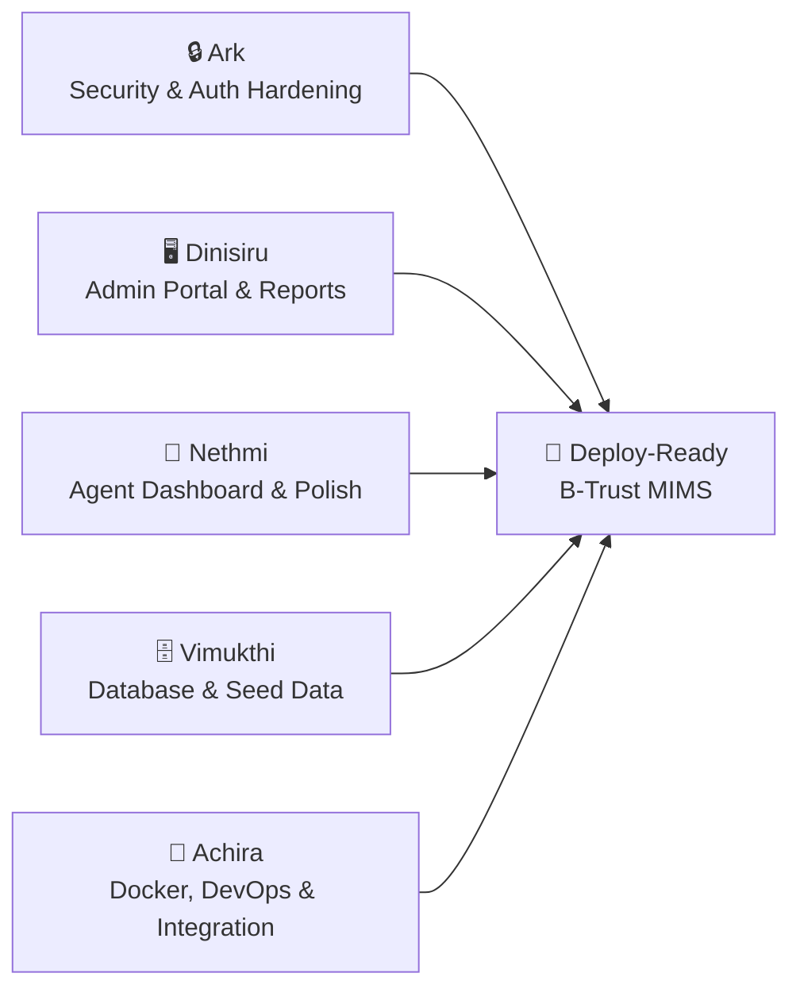
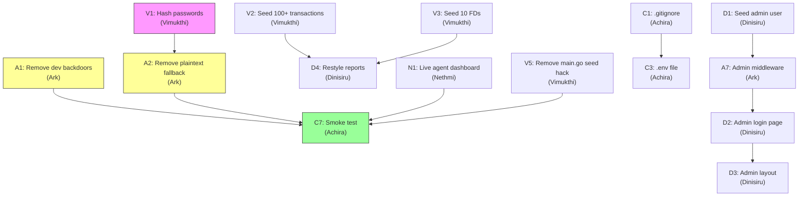

# B-Trust MIMS — Final Sprint Plan

## Goal
Complete, harden, and polish the B-Trust Microbanking & Interest Management System so it is **fully functional, secure, and deployable on a public server**. This plan assigns every remaining task to one of 5 team members with clear deliverables.

---

## Current State Summary (What's Already Done ✅)

| Area | Status |
|------|--------|
| Database schema (12 tables, constraints, FKs) | ✅ Complete |
| 5 Account types (Children, Teen, Adult, Senior, Joint) | ✅ Complete |
| 3 FD Plans (6m/12m/36m with correct rates) | ✅ Complete |
| Transaction trigger (auto balance, min-balance enforcement) | ✅ Complete |
| FD interest stored procedure + 30-day MySQL event | ✅ Complete |
| 7 Database views for reports | ✅ Complete |
| Customer login/logout (bcrypt + session tokens) | ✅ Partial (see security issues below) |
| Customer dashboard, savings, FD viewing, transfers | ✅ Complete |
| Agent sidebar layout + dashboard | ✅ Partial (dashboard shows hardcoded "--" values) |
| Agent: register customer, open account, open FD | ✅ Complete |
| Agent: teller deposit/withdraw | ✅ Complete |
| Agent: portfolio (my customers + 30-day ledger) | ✅ Complete |
| Admin reports page (5 tabbed reports) | ✅ Complete |
| Reports backend (generic view-to-JSON handler) | ✅ Complete |
| Docker containerization (MySQL + Go + Next.js) | ✅ Complete |
| Seed data (3 branches, 5 agents, 15 customers, 10 accounts) | ✅ Partial |

---

## 🚨 Critical Issues Found During Audit

> [!CAUTION]
> ### 1. Passwords are stored as PLAIN TEXT in the database seed files
> [seed_auth.sql](file:///d:/B-Trust-MIMS/database/seed_auth.sql) stores agent passwords as `'hash123'` (plain text). [seed_accounts.sql](file:///d:/B-Trust-MIMS/database/seed_accounts.sql) stores customer passwords as `'pass1'`, `'pass2'` etc. Only `agent_achira` gets a real bcrypt hash (from `main.go` line 82). The login handler on [auth.go line 110](file:///d:/B-Trust-MIMS/backend/auth.go#L108-L114) has a **plaintext fallback** — if bcrypt comparison fails, it checks `storedHash != req.Password` directly. This must be removed.

> [!CAUTION]
> ### 2. Auth bypass backdoors in production code
> - [auth.go line 66-71](file:///d:/B-Trust-MIMS/backend/auth.go#L65-L71): `getAuthenticatedUser` falls back to `?test_user=` query param and then returns `"cust_1"` if no session is found. **Anyone on the internet could access any customer's data without logging in.**
> - [auth.go line 229-234](file:///d:/B-Trust-MIMS/backend/auth.go#L228-L236): `GetStaffPersonID` falls back to returning the first agent in the database if no session token exists. **Anyone could perform agent actions without logging in.**

> [!CAUTION]
> ### 3. No `.gitignore` file — secrets are committed to GitHub
> The backend `.env` file containing `DB_PASSWORD=ArkeSabay@2k4` and the `docker-compose.yml` with the same password are both committed to the repository with no `.gitignore`.

> [!WARNING]
> ### 4. CORS is set to wildcard `*`
> [main.go line 27](file:///d:/B-Trust-MIMS/backend/main.go#L27): `Access-Control-Allow-Origin: *` allows any website on the internet to make API calls to the backend.

> [!WARNING]
> ### 5. Cookies missing `Secure` flag
> [auth.go line 140-147](file:///d:/B-Trust-MIMS/backend/auth.go#L140-L147): Session cookies do not have `Secure: true`, meaning they can be transmitted over unencrypted HTTP.

> [!WARNING]
> ### 6. No admin login role or route protection
> The `admin/reports` page is accessible to anyone — there is no admin login, no session check, and no admin user seeded in the database.

> [!WARNING]
> ### 7. OTP_TOKEN table exists but is completely unused
> The schema has an `OTP_TOKEN` table ready for email-based 2FA, but no backend code implements it.

> [!WARNING]
> ### 8. Only 6 transactions seeded (requirement: ~100)
> The seed data has only 6 transactions, making the reports look empty.

> [!NOTE]
> ### 9. Agent dashboard shows hardcoded placeholder values
> [agent/dashboard/page.tsx](file:///d:/B-Trust-MIMS/frontend/app/agent/dashboard/page.tsx) shows `--` for all metrics instead of fetching real data.

> [!NOTE]
> ### 10. No rate limiting on login endpoint
> An attacker could brute-force passwords at unlimited speed.

---

## Team Assignments



---

## 🔒 Ark — Security & Authentication Hardening

**Priority: HIGHEST — Nothing else matters if the app is insecure**

### Task A1: Remove all dev backdoors from `auth.go`
**File:** [backend/auth.go](file:///d:/B-Trust-MIMS/backend/auth.go)

Remove the development fallbacks that bypass authentication:

```go
// DELETE these lines (65-71) from getAuthenticatedUser:
// $$$ 2. Development Testing Fallbacks $$$
urlUser := strings.TrimSpace(r.URL.Query().Get("test_user"))
if urlUser != "" {
    return urlUser, nil
}
return "cust_1", nil

// REPLACE with:
return "", errors.New("unauthorized: no valid session")
```

```go
// DELETE these lines (229-236, 250-254) from GetStaffPersonID:
// All the "Fallback for development" blocks
// REPLACE with proper error returns:
return 0, errors.New("unauthorized: missing session token")
```

### Task A2: Remove plaintext password fallback from login
**File:** [backend/auth.go](file:///d:/B-Trust-MIMS/backend/auth.go#L108-L114)

```go
// CURRENT (INSECURE):
err = bcrypt.CompareHashAndPassword([]byte(storedHash), []byte(req.Password))
if err != nil {
    if storedHash != req.Password {    // ← REMOVE THIS FALLBACK
        http.Error(w, "Invalid username or password", http.StatusUnauthorized)
        return
    }
}

// REPLACE WITH (SECURE):
err = bcrypt.CompareHashAndPassword([]byte(storedHash), []byte(req.Password))
if err != nil {
    http.Error(w, "Invalid username or password", http.StatusUnauthorized)
    return
}
```

### Task A3: Add `Secure` flag to session cookies
**File:** [backend/auth.go](file:///d:/B-Trust-MIMS/backend/auth.go#L140-L147)

Add `Secure: true` to both the login and logout cookie blocks:
```go
http.SetCookie(w, &http.Cookie{
    Name:     "session_id",
    Value:    sessionToken,
    Path:     "/",
    Expires:  expiresAt,
    HttpOnly: true,
    Secure:   true,           // ← ADD THIS
    SameSite: http.SameSiteLaxMode,
})
```

### Task A4: Restrict CORS to known origins
**File:** [backend/main.go](file:///d:/B-Trust-MIMS/backend/main.go#L25-L37)

```go
// CURRENT:
w.Header().Set("Access-Control-Allow-Origin", "*")

// REPLACE WITH:
origin := r.Header.Get("Origin")
allowedOrigins := map[string]bool{
    "http://localhost:3000":    true,
    "http://frontend:3000":    true,
    // Add your production domain here when deploying
}
if allowedOrigins[origin] {
    w.Header().Set("Access-Control-Allow-Origin", origin)
}
w.Header().Set("Access-Control-Allow-Credentials", "true")
```

### Task A5: Add login rate limiting middleware
**File:** [backend/auth.go](file:///d:/B-Trust-MIMS/backend/auth.go) — new function

Add a simple in-memory rate limiter (max 5 failed attempts per IP in 15 minutes):

```go
import "sync"

var (
    loginAttempts = make(map[string][]time.Time)
    loginMu       sync.Mutex
)

func isRateLimited(ip string) bool {
    loginMu.Lock()
    defer loginMu.Unlock()

    cutoff := time.Now().Add(-15 * time.Minute)
    attempts := loginAttempts[ip]

    // Prune old attempts
    valid := attempts[:0]
    for _, t := range attempts {
        if t.After(cutoff) {
            valid = append(valid, t)
        }
    }
    loginAttempts[ip] = valid
    return len(valid) >= 5
}

func recordFailedLogin(ip string) {
    loginMu.Lock()
    defer loginMu.Unlock()
    loginAttempts[ip] = append(loginAttempts[ip], time.Now())
}
```

Then in `LoginHandler`, before checking credentials:
```go
clientIP := strings.Split(r.RemoteAddr, ":")[0]
if isRateLimited(clientIP) {
    http.Error(w, "Too many login attempts. Try again in 15 minutes.", http.StatusTooManyRequests)
    return
}
// ... after failed password check:
recordFailedLogin(clientIP)
```

### Task A6: Implement Email OTP for Admin Login (using OTP_TOKEN table)
**File:** NEW — `backend/otp.go`

The `OTP_TOKEN` table already exists in the schema. Implement:

1. **`POST /api/auth/otp/send`** — Generate a 6-digit OTP, hash it with bcrypt, store in `OTP_TOKEN`, and send via SMTP (using Go's `net/smtp` or an env-configured SMTP service).
2. **`POST /api/auth/otp/verify`** — Accept the OTP, compare against hashed value in `OTP_TOKEN`, and if valid + not expired, create a session in `USER_SESSION`.
3. Use environment variables: `SMTP_HOST`, `SMTP_PORT`, `SMTP_USER`, `SMTP_PASS`, `SMTP_FROM`.

### Task A7: Add middleware to protect admin routes
**File:** [backend/main.go](file:///d:/B-Trust-MIMS/backend/main.go)

Create a `requireAdmin` middleware wrapper:
```go
func requireAdmin(db *sql.DB, next http.HandlerFunc) http.HandlerFunc {
    return func(w http.ResponseWriter, r *http.Request) {
        username, err := getAuthenticatedUser(r, db)
        if err != nil || username == "" {
            http.Error(w, "Unauthorized", http.StatusUnauthorized)
            return
        }
        var userType string
        db.QueryRowContext(r.Context(),
            "SELECT type FROM USER_ACCOUNT WHERE username = ?", username,
        ).Scan(&userType)
        if userType != "admin" {
            http.Error(w, "Forbidden: admin access required", http.StatusForbidden)
            return
        }
        next(w, r)
    }
}
```

Then wrap the reports route:
```go
http.Handle("/api/reports/", requireAdmin(db, ReportsHandler(db)))
```

### Verification
- [ ] Try accessing `/api/customer/accounts` without a session → should get 401
- [ ] Try accessing `/api/fd/open` without agent session → should get 403
- [ ] Try logging in with plain text password → should fail
- [ ] Try logging in with bcrypt-hashed password → should succeed
- [ ] Try 6 rapid failed logins from same IP → 6th should get 429
- [ ] Try accessing `/api/reports/agents` without admin session → should get 403
- [ ] Run `go build .` in backend/ → must compile

---

## 🖥️ Dinisiru — Admin Portal & Reports Dashboard

### Task D1: Seed an admin user account
**File:** [database/seed_auth.sql](file:///d:/B-Trust-MIMS/database/seed_auth.sql)

Add at the end of the file:
```sql
-- 5. Create 1 Admin Login Account
INSERT INTO USER_ACCOUNT (username, password_hash, email, type, status)
VALUES ('admin_btrust', '<bcrypt_hash_of_admin123>', 'admin@btrust.lk', 'admin', 'active');
```

Generate the bcrypt hash by running in Go:
```go
hash, _ := bcrypt.GenerateFromPassword([]byte("admin123"), bcrypt.DefaultCost)
fmt.Println(string(hash))
```

### Task D2: Build admin login page
**File:** NEW — `frontend/app/admin/login/page.tsx`

A simple login form identical to the customer login page but:
- Title: "Admin Portal Login"
- After successful login, redirect to `/admin/reports`
- Only accept users with `role === "admin"`

### Task D3: Add admin layout with logout and navigation
**File:** NEW — `frontend/app/admin/layout.tsx`

Create a layout component for the admin section:
- Header bar with "B-Trust Admin" branding
- Logout button (calls `/api/auth/logout`)
- Session check on mount — if no session or role !== admin, redirect to `/admin/login`

### Task D4: Restyle the admin reports page to match the design system
**File:** [frontend/app/admin/reports/page.tsx](file:///d:/B-Trust-MIMS/frontend/app/admin/reports/page.tsx)

The current reports page uses an `indigo-600` color scheme. Update to match the project's Navy/Cyan design system:
- Replace `indigo-600` → `#001F3F` (Navy)
- Replace `indigo-600 text-white` tabs → `bg-[#001F3F] text-white`
- Add the `Authorization: Bearer` header to fetch calls
- Add session check — redirect to `/admin/login` if not authenticated

### Task D5: Add "Download CSV" export to each report tab
**File:** [frontend/app/admin/reports/page.tsx](file:///d:/B-Trust-MIMS/frontend/app/admin/reports/page.tsx)

Add a "Download CSV" button next to each report heading that:
1. Takes the current `rows` data
2. Converts to CSV format (headers from `COLUMNS[activeTab]`)
3. Triggers a browser file download named `btrust_{reportType}_{date}.csv`

### Verification
- [ ] Navigate to `/admin/login` → see login form
- [ ] Login with `admin_btrust` / `admin123` → redirected to `/admin/reports`
- [ ] All 5 report tabs load real data from the backend
- [ ] Click "Download CSV" → downloads a valid CSV file
- [ ] Logout → redirected back to `/admin/login`
- [ ] Try accessing `/admin/reports` without logging in → redirected to `/admin/login`

---

## 🎨 Nethmi — Agent Dashboard & Frontend Polish

### Task N1: Make the agent dashboard load real data
**File:** [frontend/app/agent/dashboard/page.tsx](file:///d:/B-Trust-MIMS/frontend/app/agent/dashboard/page.tsx)

Currently shows hardcoded `--` placeholders. Replace with a `"use client"` component that:
1. Fetches `/api/agent/stats` (gets `total_transactions`, `total_value`)
2. Fetches `/api/agent/customers` (gets customer count from array length)
3. Displays real numbers in the 3 KPI cards
4. Add quick-action cards below (links to Register Customer, Open Account, Open FD, Teller)

### Task N2: Add agent logout button to the sidebar
**File:** [frontend/app/agent/layout.tsx](file:///d:/B-Trust-MIMS/frontend/app/agent/layout.tsx) and [frontend/components/AgentHeader.tsx](file:///d:/B-Trust-MIMS/frontend/components/AgentHeader.tsx)

Add a logout button at the bottom of the sidebar:
```tsx
<button onClick={handleLogout} className="...">
  <LogOut size={18} /> Logout
</button>
```

Also add session validation on mount — if no session exists in localStorage, redirect to `/login`.

### Task N3: Add a `/customer/settings` page (placeholder)
**File:** NEW — `frontend/app/customer/settings/page.tsx`

The customer dashboard links to `/customer/settings` but the page doesn't exist. Create a simple settings page showing:
- Account username (from localStorage)
- "Change Password" section (form that calls a future API)
- "Contact Support" with agent contact info placeholder

### Task N4: Style consistency audit across all pages
Review every page and ensure:
- All pages use the Navy `#001F3F` / Cyan `#06B6D4` / Gray `#F3F4F6` color palette
- No page uses the old `slate-950` dark theme
- All error messages use the red alert card pattern
- All loading states use the spinning circle pattern
- The `/login` page redirects based on role (customer → `/customer/dashboard`, staff → `/agent/dashboard`, admin → `/admin/reports`)

### Task N5: Add the root page redirect
**File:** [frontend/app/page.tsx](file:///d:/B-Trust-MIMS/frontend/app/page.tsx)

The root `/` should auto-redirect to `/login`:
```tsx
"use client";
import { useEffect } from "react";
import { useRouter } from "next/navigation";

export default function HomePage() {
  const router = useRouter();
  useEffect(() => { router.replace("/login"); }, [router]);
  return null;
}
```

### Verification
- [ ] Agent dashboard shows real numbers (not `--`)
- [ ] Agent logout works and redirects to `/login`
- [ ] Customer settings page loads without 404
- [ ] Root `/` redirects to `/login`
- [ ] All pages follow the Navy/Cyan color scheme

---

## 🗄️ Vimukthi — Database, Seed Data & Password Hashing

### Task V1: Hash ALL seed passwords with bcrypt
**Files:** [database/seed_auth.sql](file:///d:/B-Trust-MIMS/database/seed_auth.sql) and [database/seed_accounts.sql](file:///d:/B-Trust-MIMS/database/seed_accounts.sql)

Write a small Go script to generate bcrypt hashes for every password, then update the seed files:

```go
// Run this once to generate hashes:
passwords := []string{"password123", "pass1", "pass2", ..., "pass15", "admin123"}
for _, p := range passwords {
    hash, _ := bcrypt.GenerateFromPassword([]byte(p), bcrypt.DefaultCost)
    fmt.Printf("'%s' → '%s'\n", p, string(hash))
}
```

Replace every `'hash123'`, `'pass1'`, etc. in the seed SQL files with the actual bcrypt hashes.

> [!IMPORTANT]
> After this change, the plaintext fallback in `auth.go` (Ark's Task A2) MUST also be removed, or logins will break.

### Task V2: Expand seed transactions to 100+
**File:** [database/seed_accounts.sql](file:///d:/B-Trust-MIMS/database/seed_accounts.sql)

Currently only 6 transactions exist. Add **~100 realistic transactions** spread across:
- Multiple accounts (at least 8 of the 10 accounts)
- Multiple agents (all 5 agents processing transactions)
- Mix of deposits, withdrawals, and interest credits
- Dates spread over the last 60 days
- Realistic amounts (LKR 500 – 50,000)
- Include transfers with matching reference numbers

Example pattern:
```sql
INSERT INTO TRANSACTION (account_no, staff_person_id, txn_type, amount, balance_after, timestamp, reference_no) VALUES
('ACC000000001', 1, 'deposit', 5000.00, 0, '2026-08-15 09:30:00', NULL),
('ACC000000002', 2, 'withdrawal', 2000.00, 0, '2026-08-16 14:15:00', NULL),
-- ... 100 more rows
```

> [!NOTE]
> The `balance_after` will be auto-calculated by the `before_transaction_insert` trigger. Set it to `0` — the trigger handles it. BUT transactions must be inserted **in chronological order** for balances to be correct. Update the final `SAVINGS_ACCOUNT` balances accordingly.

### Task V3: Seed 10 Fixed Deposits (requirement says "at least 10")
**File:** [database/seed_accounts.sql](file:///d:/B-Trust-MIMS/database/seed_accounts.sql)

Currently only 1 FD exists. Add 9 more across different accounts:
```sql
INSERT INTO FIXED_DEPOSIT (fd_acc_no, account_no, fd_plan_id, investment, start_date, interest_paid_to_date, next_payout_date) VALUES
('FD000000001', 'ACC000000001', 1, 1000.00, '2026-09-16', 0.00, '2026-10-16'),
('FD000000002', 'ACC000000002', 2, 5000.00, '2026-09-01', 0.00, '2026-10-01'),
('FD000000003', 'ACC000000003', 3, 10000.00, '2026-08-20', 0.00, '2026-09-19'),
-- ... 7 more FDs (one per account that allows it)
```

> [!IMPORTANT]
> Each savings account can only have 1 FD (UNIQUE constraint `uq_fd_account_no`). Make sure no two FDs reference the same `account_no`. Since we have 10 savings accounts, we can have up to 10 FDs.

### Task V4: Add indexes.sql to Docker initialization
**File:** [docker-compose.yml](file:///d:/B-Trust-MIMS/docker-compose.yml)

The `indexes.sql` file exists but is NOT loaded by Docker. Add it to the init chain:
```yaml
volumes:
  - ./database/schema.sql:/docker-entrypoint-initdb.d/1-schema.sql
  - ./database/indexes.sql:/docker-entrypoint-initdb.d/1b-indexes.sql   # ← ADD
  - ./database/triggers.sql:/docker-entrypoint-initdb.d/2-triggers.sql
  # ... rest unchanged
```

### Task V5: Remove the hardcoded agent_achira seed from main.go
**File:** [backend/main.go](file:///d:/B-Trust-MIMS/backend/main.go#L82-L95)

Once all seed passwords are properly bcrypt-hashed in the SQL files, remove the runtime seeding hack:
```go
// DELETE lines 82-95 (the hashedPwd block that seeds agent_achira at startup)
```

### Verification
- [ ] Run `docker-compose down -v && docker-compose up --build`
- [ ] All 5 agents can log in with `password123`
- [ ] All 15 customers can log in with `pass1` through `pass15`
- [ ] Admin can log in with `admin123`
- [ ] The admin reports show data in all 5 tabs
- [ ] Active FDs report shows 10 FDs
- [ ] Transaction history shows 100+ transactions

---

## 🐳 Achira — Docker, DevOps & Integration Testing

### Task C1: Create a proper `.gitignore`
**File:** NEW — `.gitignore` at project root

```gitignore
# Environment secrets
.env
backend/.env

# Dependencies
node_modules/
frontend/node_modules/
frontend/.next/

# Build artifacts
backend/backend
backend/backend.exe

# Docker volumes
db_data/

# OS files
.DS_Store
Thumbs.db

# IDE
.vscode/
.idea/

# Gemini
.gemini/
```

### Task C2: Create a root `.env.example` template
**File:** NEW — `.env.example` at project root

```env
# Database
DB_ROOT_PASSWORD=change_me_in_production
DB_USER=root
DB_HOST=db
DB_PORT=3306
DB_NAME=btrust

# SMTP (for OTP emails)
SMTP_HOST=smtp.gmail.com
SMTP_PORT=587
SMTP_USER=your-email@gmail.com
SMTP_PASS=your-app-password
SMTP_FROM=noreply@btrust.lk

# Frontend
BACKEND_URL=http://backend:8080
```

### Task C3: Create a root `.env` file (not committed)
**File:** NEW — `.env` at project root (will be gitignored)

Copy `.env.example` and fill in real values. Update `docker-compose.yml` to use it:
```yaml
services:
  db:
    env_file: .env
    environment:
      MYSQL_ROOT_PASSWORD: ${DB_ROOT_PASSWORD}
      MYSQL_DATABASE: ${DB_NAME}
```

### Task C4: Add `events.sql` to Docker initialization
**File:** [docker-compose.yml](file:///d:/B-Trust-MIMS/docker-compose.yml)

The `events.sql` (MySQL scheduled event for FD interest) is not loaded. Add it:
```yaml
volumes:
  - ./database/events.sql:/docker-entrypoint-initdb.d/7-events.sql
```

### Task C5: Add Nginx reverse proxy for HTTPS (production)
**Files:** NEW — `nginx/nginx.conf`, `nginx/Dockerfile`, update `docker-compose.yml`

Add an Nginx container that:
1. Terminates SSL (using Let's Encrypt or self-signed cert for testing)
2. Proxies `/` to `frontend:3000`
3. Proxies `/api/` to `backend:8080`
4. Adds security headers (HSTS, X-Frame-Options, CSP)

```nginx
server {
    listen 443 ssl;
    server_name btrust.example.com;

    ssl_certificate     /etc/nginx/certs/fullchain.pem;
    ssl_certificate_key /etc/nginx/certs/privkey.pem;

    location / {
        proxy_pass http://frontend:3000;
        proxy_set_header Host $host;
        proxy_set_header X-Real-IP $remote_addr;
    }

    location /api/ {
        proxy_pass http://backend:8080;
        proxy_set_header Host $host;
        proxy_set_header X-Real-IP $remote_addr;
    }

    # Security headers
    add_header X-Frame-Options "DENY" always;
    add_header X-Content-Type-Options "nosniff" always;
    add_header Strict-Transport-Security "max-age=31536000; includeSubDomains" always;
}
```

### Task C6: Update README.md with deployment instructions
**File:** [README.md](file:///d:/B-Trust-MIMS/README.md)

Write a complete README covering:
1. Project description
2. Architecture diagram (Frontend → Backend → MySQL)
3. Prerequisites (Docker, Docker Compose)
4. Quick start: `cp .env.example .env && docker-compose up --build`
5. Default login credentials table
6. API endpoints reference
7. Development setup (without Docker)

### Task C7: Integration smoke test script
**File:** NEW — `scripts/smoke-test.sh` (or `.ps1` for Windows)

A script that:
1. Waits for all 3 containers to be healthy
2. Tests login with a customer account
3. Tests login with an agent account
4. Tests login with the admin account
5. Tests fetching savings history
6. Tests a deposit transaction
7. Tests fetching reports
8. Prints PASS/FAIL summary

```powershell
# Example smoke test structure:
Write-Host "Testing customer login..."
$response = Invoke-RestMethod -Uri "http://localhost:3000/api/auth/login" `
  -Method POST -ContentType "application/json" `
  -Body '{"username":"cust_1","password":"pass1"}'
if ($response.status -eq "success") { Write-Host "✅ Customer login" }
else { Write-Host "❌ Customer login FAILED" }
```

### Verification
- [ ] `.gitignore` prevents `.env` from being committed
- [ ] `docker-compose down -v && docker-compose up --build` → all 3 containers healthy
- [ ] Smoke test script passes all checks
- [ ] Nginx serves HTTPS (self-signed cert OK for testing)

---

## Coordination & Execution Order



### Phase 1 (Do First — Can be parallel)
| Who | Task | Est. Time |
|-----|------|-----------|
| Vimukthi | V1: Hash passwords in seed SQL | 1 hour |
| Vimukthi | V2: Write 100+ transactions | 2 hours |
| Vimukthi | V3: Seed 10 FDs | 30 min |
| Ark | A1: Remove dev backdoors | 30 min |
| Ark | A3: Secure cookie flag | 15 min |
| Ark | A4: Fix CORS | 30 min |
| Achira | C1: Create .gitignore | 15 min |
| Achira | C2: Create .env.example | 15 min |
| Dinisiru | D1: Seed admin user | 30 min |
| Nethmi | N1: Agent dashboard real data | 1.5 hours |
| Nethmi | N5: Root page redirect | 15 min |

### Phase 2 (After Phase 1)
| Who | Task | Depends On |
|-----|------|------------|
| Ark | A2: Remove plaintext fallback | V1 |
| Ark | A5: Rate limiting | A1 |
| Ark | A7: Admin middleware | D1 |
| Dinisiru | D2: Admin login page | A7, D1 |
| Dinisiru | D3: Admin layout | D2 |
| Dinisiru | D4: Restyle reports | V2, V3 |
| Nethmi | N2: Agent logout + session guard | A1 |
| Nethmi | N3: Customer settings page | — |
| Nethmi | N4: Style audit | — |
| Vimukthi | V4: Add indexes to Docker | — |
| Vimukthi | V5: Remove main.go seed hack | V1 |
| Achira | C3: Root .env file | C1, C2 |
| Achira | C4: Add events.sql to Docker | — |

### Phase 3 (Final Polish)
| Who | Task | Depends On |
|-----|------|------------|
| Ark | A6: Email OTP | A7 |
| Dinisiru | D5: CSV export | D4 |
| Achira | C5: Nginx HTTPS proxy | C3 |
| Achira | C6: README.md | All |
| Achira | C7: Smoke test | All |

---

## Test Login Credentials (After All Changes)

| Role | Username | Password | Where to Login |
|------|----------|----------|----------------|
| Customer | `cust_1` | `pass1` | `/login` |
| Customer | `cust_2` | `pass2` | `/login` |
| Agent | `agent_achira` | `password123` | `/login` |
| Agent | `agent_ark` | `password123` | `/login` |
| Admin | `admin_btrust` | `admin123` | `/admin/login` |

---

## Open Questions

> [!IMPORTANT]
> ### Q1: SMTP Provider for Email OTP
> Which email service should we use for sending OTP codes? Options:
> - **Gmail App Password** (free, simplest for testing)
> - **SendGrid** (free tier: 100 emails/day)
> - **Amazon SES** (cheapest for production)
> 
> **Recommendation:** Use Gmail App Password for now; switch to SendGrid for production.

> [!IMPORTANT]
> ### Q2: Production Domain & SSL Certificate
> Do you have a domain name for deployment? If yes, we can use Let's Encrypt for free SSL. If not, we'll use a self-signed certificate for the demo.

> [!IMPORTANT]
> ### Q3: Server for Deployment
> Where will this be hosted?
> - University server
> - DigitalOcean / AWS / Azure (paid)
> - Local network demo only


## October 6, 2026 - Progress Update by Arkeshan
- **Admin Email OTP 2FA:** Implemented secure OTP verification via email for Admin login.
- **Rate Limiting:** Enforced a strict 5-minute cooldown between OTP requests.
- **Session Persistence:** Prevented the 'Back button' loophole by restoring the countdown timer using backend validation and frontend sessionStorage.
- **Safe Logout:** Added complete session invalidation (cookie clearance + DB record deletion) for Admin.
- **Minimalist UI:** Removed unnecessary placeholders and icons from the login page to adhere to strict design guidelines.
- **Hardcoded Passwords Removed:** Ensured the Admin password is no longer hardcoded in the Go source code.

## October 8–9, 2026 - Cloud Deployment & Infrastructure Hardening (Arkeshan)
- **Aiven Cloud MySQL Migration:** Successfully deployed and populated all 7 database schemas, stored procedures, triggers, views, and seed tables on Aiven Managed MySQL with SSL/TLS encryption.
- **Render.com Backend Deployment:** Containerized and hosted the Go REST API on Render Web Services with dynamic `$PORT` binding and TLS handshake support.
- **Vercel Frontend Deployment:** Hosted the Next.js 16 application on Vercel (`btrust2.vercel.app`) with custom domain routing.
- **Automatic Root Redirect:** Implemented server-side `redirect("/login")` on `/` so the base domain lands directly on the banking portal without template placeholders.
- **Dual-Channel 2FA OTP Delivery:** Integrated Resend HTTPS API (port 443) into `backend/otp.go` to bypass cloud firewall restrictions on SMTP port 587, ensuring guaranteed real-time email OTP delivery directly to admin Gmail inboxes.
- **Graceful Error Handling:** Sanitized `BACKEND_URL` rewrite rules and added Content-Type safety checks to prevent raw `<!DOCTYPE` syntax errors during cloud backend wake-ups.

